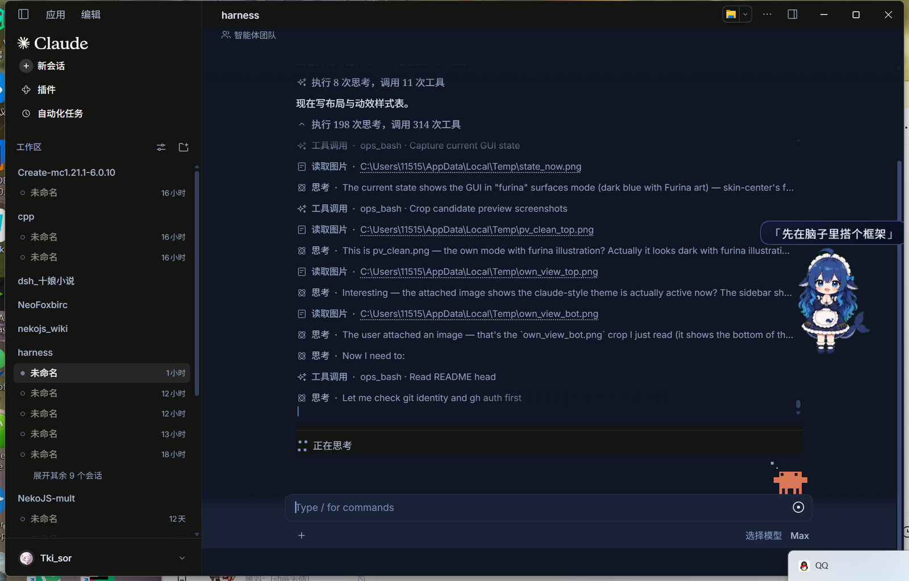
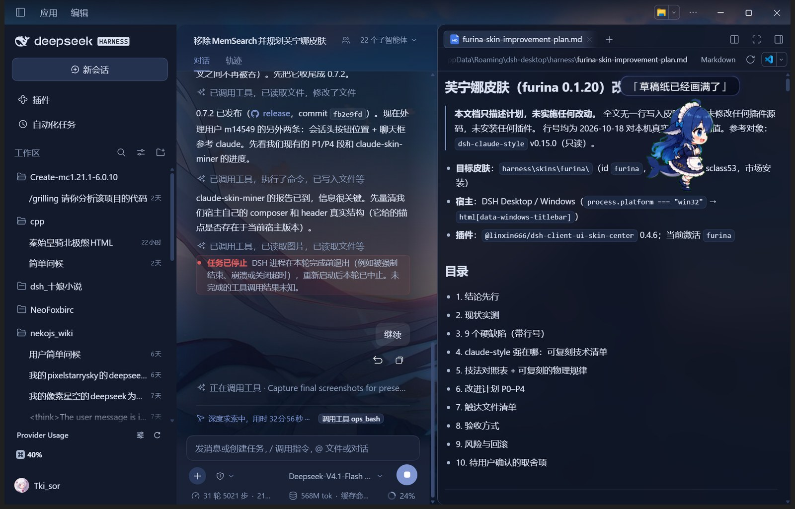

# dsh-furina-style

> 芙宁娜水色 × Claude 风格的布局与动效 —— 给 DeepSeek Harness Web GUI 的独立主题插件。



一个**纯客户端**的 DSH bundle 插件：零 Host 能力、零第三方依赖、零构建依赖。
它做四件事：

1. **配色**：一套冷调「水与珍珠」的调色板（亮 / 暗各自独立设计），覆盖宿主
   全部 `--dsw-alias-*` 语义 token；
2. **背景**：默认铺一张芙宁娜插画，上面盖一层可调浓度的纱，强度、模式都在
   **DeepSeek 设置界面**里调；
3. **布局**：借鉴 claude-style 的几何纪律 —— 独立水面式的输入卡、压薄的会话头、
   32px 行高的弹层、发丝线边框与墨色焦点环（**但不复制它的吉祥物、彩蛋**），
   外加一层只补质感的精修（会话头 / 标签页 / 侧栏 / 输入卡 / 弹层）；
4. **动效**：把所有时长 / 曲线 / 距离做成 `--fh-*` 令牌，克制的入场、反馈、
   循环呼吸三层节奏，并自带 reduced-motion 双保险；
   外加两处「宿主说不出来」的活体信息：右侧那列对话导航短横线的水色与
   `Alt+↑/↓` 跳轮、运行行末尾的「在做什么」小胶囊。

卸载插件会移除 `<html>` 上的命名空间属性、注入的样式及注册的控件 / 监听器，
恢复原生界面。

> **0.2.0 起**：配置项移进了「设置 → 芙宁娜主题」，不再需要手改 localStorage；
> 默认背景图换成芙宁娜插画；顺手修掉了输入框下方 40px 悬空。
> **0.3.0 起**：去掉「隐藏第三方吉祥物 / 封号彩蛋 / 桌宠」三个开关 ——
> 主题只负责自己的表面，不替别的插件做内容策略。
> **0.4.1 起**：精修层 + 对话导航条 + 运行状态细节三件套；正文水膜浓度可调；
> Windows 右上角那三个原生窗口按钮不再是黑底。
> **0.5.0 起**：图片显示大小（你发的 / AI 发的分别可调）、引用块底色四档色调
> 与浓度都可调；精修层补到 P9（代码块 banner、对话里的「重试 / 中断」行）。
> **0.6.0 起**：连续多张图片默认**横排并列 + 底部横向滚动条**，
> 你发的和 AI 发的可以分别选「并列 / 堆叠」。
> **0.7.0 起**：右侧边栏（终端 / 文件 / 浏览器那一栏）不再是整块实色，
> 改成浮在水面上的磨砂玻璃；宿主一批「从未被主题接管」的中性灰按钮色
> 统一收进蓝紫色阶。
> **0.7.1 起**：右侧边栏标签条的三处错位修好了 —— 右上角三个图标按钮与标签
> 共线、「+」不再偏下、那条假的横向滚动条消失，长标题也能展开到 280px。
> **0.7.2 起**：标签标题不再被渐隐 mask 白吃一截 —— 只有真的装不下才渐隐，
> 装得下就完整显示，关闭叉与文字之间留出干净的 2px。
> **0.8.0 起**：会话头那两个按钮（「用文件资源管理器打开」+「更多操作」）
> 搬进 Windows 原生标题栏，和窗口三键同一行；输入框从「一整块大卡」改成
> 宿主式的**输入区独立成卡 + 工具行浮在卡下**，两件事都能在设置里关掉。
> **0.9.0 起**：右侧边栏的标签文字不再被渐隐吃掉（根因是我们自己一条
> `::before` 撑出的 9px 幻影溢出）；输入框里换成**平滑移动的光标**
> （自绘一条细线跟着走，保留原生 1s 闪烁），可在设置里关掉。
> **0.10.0 起**：整条输入区按 claude 的几何重排 —— 工具行钉成恒定 28px 单行、
> 「+」搬进卡面内部左下变成 24×24 圆角方块、发送键搬进卡面内部右下，
> 权限 / 模型落到卡下同一行；设置页去卡片化（行 + 0.5px 分隔线、行标题 14/400）；
> 右侧栏账号行与它 portal 出来的菜单、会话头右上那颗 dock 开关也一并对齐 claude。
> **0.11.0 起**：正文里那些「宿主只画了底色、没画边界」的容器补上发丝外框 ——
> 代码块、宽表格、你自己发出去的附件卡；焦点环同时收窄到「真有焦点语义」的
> 控件，并跟住宿主的指针模态契约（鼠标点出来的不亮环）。
> **0.12.0 起**：第一次动**字号本身** —— 宿主的标题阶梯原本是 21/19/18/14/14/14
> （后三级完全塌平，h5 和 h6 在屏幕上没有区别），现在修成 21/18/16/14/13/12，
> 上下留白也从「跟着字号走的 em」换成 30/26/22/18/16 的一根显式标尺；行内代码
> 从 12.25 这种分数像素回到 13px 整数。
> **0.13.0 起**：新会话那一屏按 claude 的构图收拢（标题 20/26 左对齐、内容列 720、
> 标题 / 工作区行 / 输入卡三者同左缘）；**浅色主题下的小字第一次真的能读** ——
> 四个公共墨色下沉、品牌色压到 `#2a3660`，同时把暗色的品牌色钉回原值不受牵连；
> 另外修掉三条「写了但从来没命中过」的动效选择器。

> **0.14.0 起**：任务栏与输入框等宽；权限、会话统计、模型选择合并为卡下同一行。
> 窄面板保留可点击统计图标与原生详情，静态统计文字仍可读，不隐藏它的唯一标签。

### 0.15.0 做了什么

继续对齐 Claude 的输入区控件，但保留芙宁娜的水色：

- **发送键**：26px 透明圆角方键，箭头换成回车式折线；停止键保留原生方块与行为。
- **模型 / 推理强度分开**：两个独立的文字按钮。模型弹层支持搜索；推理弹层是离散滑条，
  只在松手或结束键盘操作时提交。档位完全来自当前模型元数据，不预设供应商或档位 ID。
- **权限**：素文字触发器与水色菜单。仍使用宿主原生菜单、权限选项和确认流程，
  不发送额外命令，不改变安全策略。
- **上下文**：百分比与圆环收在底栏最右端，模型控件给它留出真实空间；窄输入区保留圆环。

模型控件通过宿主槽位及每会话模型目录实现，不依赖 Claude 插件，也不搬动原生 React 节点。
缺少目录 API、无可选模型、子代理会话或主题不接管时，保留原生模型选择。

验证包含真实宿主 React + 假模型目录的交互测试，以及 1923–400px 的八档宽度回归；
不会调用真实供应商或发送会话消息：

```sh
node scripts/check-composer-controls.mjs
```

此检查只连接隔离浏览器的 :5177 页面，必要时仅重载该测试页，并恢复 DOM / 视口夹具。
**构建后仍需完整退出并重启桌面应用；不要只刷新旧窗口。**

### 0.14.0 做了什么

对应两处实机反馈：

- **任务栏等宽**：去掉宿主额外扣除的四份 dock inset（合计 32px），
  与输入卡共用最大宽度及侧边留白，展开任务列表也保持对齐。
- **卡下只留一行**：左侧权限、中间统计、右侧模型选择共享三列网格。
  保留宿主 DOM、按钮与弹层，不重挂 React 节点、不把控件做成固定坐标。
- **窄面板**：按输入区实际宽度响应，而不是只看窗口宽度。≤560px 时，
  有详情弹层的统计按钮缩成图标，静态统计保留原生文字省略；模型标签可缩短。
  ≤360px 时权限保留图标。运行活动、提示条、附件及多行输入的原生结构不变。

实测：旧任务栏 720px、输入框 752px → 两者均为 752px；卡下减少一行（26px）。
使用长模型标签测试 1923 / 1570 / 1100 / 900 / 760 / 640 / 520 / 400px 窗口，
按钮和静态统计两种形态均无互相覆盖或页面横向溢出；新会话输入卡仍为 720px。

可复现检查（需已有隔离 CDP 浏览器与带任务/统计的会话，不发送消息）：

```sh
node scripts/check-composer-layout.mjs --matrix
node scripts/check-composer-layout.mjs --matrix --plain
```

测试期间的模型文字与视口夹具会恢复，不改模型配置。
改动位于 [18-composer-footer.css](src/18-composer-footer.css)。
**构建后仍需完整退出并重新启动桌面应用；不要只刷新旧窗口。**

### 0.13.0 做了什么

0.12.0 动的是**字**，这一版动的是**尺子**：一屏纸的构图，和一层字压不压得住。

两条线是分开的。第一条是实机量出来的排版缺陷没有到此为止 —— 新会话那一屏
还留着宿主的「搜索页」构图（居中大标题 + 徽标），而 claude 那一屏的重心在
输入框上。第二条是被审查按出来的：**浅色主题下，16 个文本层里有 8 层低于
WCAG 4.5:1**，最差的三层只有 2.35 / 2.46 / 2.61 —— 那不是「有点淡」，
是读不下去。

所以这一版新建了 `src/06-hero.css`（H0.1–H0.3），并把 `00-tokens.css` 的
公共调色板第一次做主题分流。

#### 一、新会话页：从「搜索页」改成「输入框当主角」（`06-hero.css` H0）

宿主那一屏是搜索页构图：标题 `26px/32px/500` **居中**、徽标跟在后头、内容列
752px。claude 是 `20px/26px/500` **左对齐**、没有徽标、内容列 720px，标题 /
工作区行 / 输入卡三者左缘与宽度完全一致。

26px 在 720 的列里是横幅，20px 才是标题；左对齐之后标题的起点和输入框的起点
落在同一条竖线上，视线不用来回跳。

难点全在锚点，三条都是实测撞出来的：

1. **宽度只改一个变量就够了。** 宿主三层的宽度是联动的 ——
   `composerHero 宽 = card-max-width + 2 × side-clearance`、`stack 宽 = min(100%, card-max-width)`、
   `card 宽 = min(100%, card-max-width)`。所以只要在 `[data-composer-seat]` 上重声明
   `--dsh-composer-card-max-width`，标题 / 工作区行 / 输入卡会一起收窄并对齐。
   反过来改 stack 宽度，只会得到「root 720 / stack 672 / card 688」这种谁都不齐的结果。
2. **那个 clamp 必须写成裸的。** `clamp(720px, 68ch, 900px)` 前面**不要**再套
   `min(calc(100% - 16px))` —— 套了之后 `100% - 16px` 会先算成 736，最终 card 落到 704。
3. **`:has()` 的层数必须数准。** hero 变体只是 class（`Dc7zOa_composerHero` /
   `RlGAzG_hero` / `Hqq-bq_headline`），没有 `data-*`，只能从具名槽反查容器。
   从 `[data-slot="conversation.hero.brand.mark"]` 往上数，**正好 4 层** `div:has()`
   才是那一屏的 root；写 3 层拿到的是 stack（会把标题再挤窄一圈），写 5 层实测 0 命中
   —— 上面没有第 5 个 div。而且不能把 `display:contents` 的槽本身数进去，它的 rect 是 0。

logo 只锁高度：`height: 21px; width: auto`。这枚 svg 的 viewBox 是 23.16 × 17.04，
钉成 21 × 21 会把它压扁。

实测（隔离实例 1570×871）：标题 / 工作区行 / 输入卡三者左缘 `x = 559`、宽 `720`，
`document.scrollWidth = 1570` 无横向溢出，标题 `20px/26px/500 flex-start`，
徽标 `display: none`，logo `29×21`。

#### 二、浅色：小字第一次真的能读（`00-tokens.css` 公共调色板）

这里得先说清根因，否则改法看起来像随便调色。

`30-surface.css:65-79` 把对话区的 `.BynINW_centerCol` / `.BynINW_bottomRow` 设成
`background: transparent !important` —— 插画是**直透正文区**的。浅色的水膜只有
`rgb(247 250 255 / 0.4)`，压在插画最亮处几乎不改变亮度，所以**浅色下遮罩救不了
对比度**，12 个文本层里有 7 层的好坏取决于背后那一片插画有多亮。

两条路摆在那儿：把水膜浓度从 0.4 拉到 0.62（一次性全部到 6.4–8.2:1），或者从
**前景色**往下沉。选了后者 —— 前者是把用户选的插画调淡，那是把背景当成错误来修；
而且拉满也救不回 `--fh-water-faint`（`#7c8bab` 压纯白也只有 3.42:1，token 自身
就不达标，换什么背景都没用）。

| token（`00-tokens.css`） | 原值 | 现值 | 依据 |
| --- | --- | --- | --- |
| `--fh-water-ink-soft` | `#3e4b6d` | `#2d3650` | 压最亮样本 `#9fa2b2` 从 3.41:1 到 4.73:1 |
| `--fh-water-mute` | `#5f6e93` | `#333b4e` | 工具行 2.61 → 4.52、缓存行 2.46 → 4.87 |
| `--fh-water-faint` | `#7c8bab` | `#42495a` | 「High」2.35 → 4.58（这一档压纯白原本只有 3.42） |
| `--fh-brand` | `#4a5fa8` | `#2a3660` | 链接 2.77 → 4.55，对白 11.7:1 |

代价写在明处：浅色的明度层次从 3 档压到 2 档。8 层逐层复算全部 ≥ 4.5:1；
只有插画极暗的两处（`#9da3af` 一带）新 faint 仍然在 3.5 左右，属残余。

#### 三、暗色：一次自己引入、又自己修掉的回归

公共调色板是声明在 `html[data-dsh-furina]` 上的，暗色块是它的后代 —— 于是
**浅色一改，暗色跟着动**。改完实测暗色的 `--fh-brand` 变成了 `#2a3660`，
那在深底上是「一块几乎看不见的深蓝」，流式光标、工具行水膜、列表 marker 这几处
装饰立刻失形。

修法是在暗色块里显式钉回 `#4a5fa8`。理由是暗色段的文字与品牌色本来就走各自
硬编码的 `--dsw-alias-*`，只有那几处装饰还引用 `--fh-brand` —— 浅色下沉不该
顺带改暗色的观感。这条教训值得记：**公共 token 放在主题块外面，等于给两个主题
装了一根共用的轴，动之前先想清楚另一头连着谁。**

顺带把暗色唯一贴线的 `--dsw-alias-label-caption` 从 `#788bb4` 抬到 `#8fa0c8`
（中位 4.64 → 6.06，最差像素 3.26 → 4.26）。它只影响暗色。

#### 四、三条「写了、但从来没命中过」的动效选择器（`20-motion.css`）

审查动效层时顺手量了一遍命中数，三条规则都在 0：

| 位置 | 旧写法 | 为什么从来没生效 |
| --- | --- | --- |
| M1 消息入场 | 给 `[data-slot="conversation.chat.node"]` 的每个子元素都挂 `animation ... both` | `animation-fill-mode: both` 在层叠里**高于普通声明**，它把行尾操作条的 `opacity` 钉在最后一帧的 1，于是 `10-layout.css:149` 那条「hover 才出现」永远算不出 0（实测 opacity 恒为 1）。加 `:not([data-turn-tail])` 排除掉 |
| M3 思考态涟漪 | `[data-chat-flow-kind="turn-process"] [data-state="running"]` | turn-process 那个 flowItem 里**根本没有** `[data-state]`（孩子只有隐藏播报和那个按钮）。真正带 `data-state="running"` 的是思考块 ReasoningRow，锚改成 `[data-variant="think"][data-state="running"]`，呼吸光挂到它那枚 16px 的 leading 图标上（挂整行会溢到相邻行） |
| M4 展开涌动 | `[data-expanded="true"]` | 宿主的写法是 `"data-expanded": expanded || void 0` —— 折叠时**整条属性不存在**，不是 `"false"`。全页 0 个 `data-expanded`，改成只判属性存在 |

#### 这一版没做的事

- **复刻 claude 的 studio 分支**（标题提前、输入卡 480 宽贴左、工作区行变托盘）。
  那套布局要求工作区行让出 37px，会和宿主自己的负 margin 打架，收益不抵风险。
- **给 hero 加入场 rise 动画。** claude 有（`.5s cubic-bezier(.22,1,.36,1)`，
  标题延后 70ms）。但新会话是**每次**都会到的屏，反复播入场很快就从「有质感」
  变成「要等」；20-motion 里已有的弹层入场已经够用。
- **拉高浅色水膜浓度。** 见第二节：那等于把用户选的插画当错误修。
- **动 `data-composer-variant`。** 宿主里这个属性 0 个 —— 判 hero 态只认 `[data-phase="hero"]`。

#### 注意

`lib/client.js` 变了（16 个 css → `269.1 kB` 样式表，`332.6 kB` 产物），宿主会认为
chunk rev 失效 —— **必须完整重启应用**，刷新页面会 404 卡在启动屏。没有新增设置项。

### 0.12.0 做了什么

0.11.0 补的是**边界**，这一版补的是**字号**。它是第一次动排版本身 ——
0.10.0 之前所有排版声明加起来只有五十来条，而且全挤在「绕着宿主走」的位置上，
`00-tokens.css` 里一条字号阶梯都没有。

起点是一次实测：宿主的标题阶梯是

```
h1 21/30    h2 19/28    h3 18/26    h4 14/24    h5 14/24    h6 14/24
```

前三级挤在 3px 以内，后三级**完全塌平**。这不是审美问题，是层级失效 ——
一段写满 `###` 和 `#####` 的文档，读到第五级和第六级时，屏幕上看不出它们
差了一级。所以这一版新建了 `src/05-typography.css`（T1–T5），把「层级」收拢
到一处，并且第一次改字号本身。

#### 一、先得知道改哪一层：token 还是元素（T1）

宿主只给 h1–h4 各一条 `font` 简写 token：

```css
--dsw-font-markdown-h2: 700 calc(19px + var(--dsh-content-font-delta))
                        / calc(28px + var(--dsh-content-font-delta)) var(--dsw-font-family);
```

元素规则是宿主自己消费它的（`._markdown h2 { font: var(--dsw-font-markdown-h2) }`）。
所以我们**覆写 token、不抢宿主的类名、也不重复声明 `font-size`** ——
层级一改，行高、字重、字体族跟着一起走，不会出现「字号变了行高没变」的错位。

改完是 h2 `18/26`、h3 `16/24`，阶梯变成 **21 / 18 / 16 / 14**：每降一级
差 3px、2px、2px，读得出层级，又不会让 h3 比正文响太多。

#### 二、h5 / h6 没有自己的 token（T2）

宿主让这两级复用 `--dsw-font-markdown-base-strong` —— 而那个 token **同时被
`strong` 用**。覆写它会把正文里所有加粗一起改小，所以这两级只能用元素规则。

方向也是反的：不往上加字号（小标题比正文还响就本末倒置了），而是往下收 ——
h5 走 `13/22` + label-secondary，h6 走 `12/20` + label-tertiary，各自加一点
字距（0.02em / 0.04em），小字号中英混排才不会挤成一条。

#### 三、间距从「em」换成一根显式标尺（T3）

原来这里只有一条 `margin-top: 1.35em`。用 em 的结果是间距**跟着标题自己的
字号走**：21px 的 h1 拿 28.35px、18px 的 h3 拿 24.3px —— 大小标题的「一口气」
几乎一样，层级感又被抹平了一次。

现在是显式的 30 / 26 / 22 / 18 / 16，步长 4 4 4 2。下边距反而收紧
（16 → 14/12/10/8/6），因为宿主给的下边距会和下一段自己的 `margin-top` 叠加，
视觉上是两份留白相加。再补一条 `标题 + 块` 的收口规则，避免「标题 → 列表 /
代码块 / 表格」之间散开。

⚠️ 这里有一条**必须遵守的尺寸纪律**，写在文件头上：

```css
font-size: calc(13px + var(--dsh-content-font-delta, 0px));
```

因为宿主把用户在设置里调的字号以**内联样式**写在 `body` 上
（`body.style.setProperty('--dsh-content-font-size', …)`）。CSS 里覆写
`--dsh-content-font-size` 会被内联样式直接压掉 —— 唯一能接的接口是宿主自己用
同一条 delta 派生的那些 `calc()`。写死 px 的后果是：用户把正文字号调大，
标题纹丝不动。

实测这条纪律是对的：把 `--dsh-content-font-size` 调到 18px 后，h2 变 22/30、
h3 变 20/28、行内代码变 17px，整条阶梯按同一个 delta 一起长。

#### 四、行内代码的分数像素（T4）

宿主给行内 code 的是 `font-size: .875em !important` —— 14px 正文里算出
**12.25px** 这种分数像素。分数字号在中英混排里会落到半个像素上，笔画边缘发灰。

改成 `calc(1em - 1px)`（= 13px），台阶回到整数，且只比正文小 7%，夹在中文
句子中间不会「跳一下」。这条**必须带 `!important`** —— 宿主那条也是
`!important`，而我们的选择器特异性 (0,4,2) 高于它的 (0,1,2)。

标题里的行内代码要单独兜回来：宿主让标题内 code 继承标题字号
（`:where(h1..h6) code { font: inherit }`），我们那条 `!important` 会把它一起
盖掉，所以补一条等价的 `1em`。

#### 五、断行质量（T5）

两条纯排版属性，不动任何尺寸：

- `p / li / blockquote` 用 `text-wrap: pretty` —— 浏览器会为了避免段末只剩
  一两个字而提前换行。中文没有空格，孤字尤其难看。
- `h1–h4` 用 `text-wrap: balance` —— 多行标题的行长被均分，不会第一行撑满、
  第二行孤零零两个字。

两条都是渐进增强：浏览器不认识就整条忽略，退回原来的断行。

#### 六、顺手退役的三条旧声明

排版第一次有了统一去处，就该把散在外面的旧声明收掉，否则以后两份规则互相
覆盖时还要去比特异性：

| 位置 | 旧声明 | 为什么退役 |
| --- | --- | --- |
| `50-details.css` D1 | `font-size: 0.92em` | **死声明** —— 没有 `!important`，被宿主 `.875em !important` 完全压掉，实测的 12.25px 全部来自宿主 |
| `50-details.css` D5 | `margin-top: 1.35em` 整节 | 迁到 T3，em 跟着字号走导致大小标题一口气几乎一样 |
| `10-layout.css` L9 | `:is(h1,h2,h3){letter-spacing:0.01em}` | 迁到 T3，和阶梯写在同一个文件里 |

#### 这一版没做的事

- **换字体族。** claude-style 的排版优势里有一半来自它自托管的四个字体文件
  （Anthropic Sans / Inter / Noto Serif / JetBrains Mono，两个可变字重）。我们
  不引入字体资源 —— 那是几 MB 的体积和一次加载竞态，换不来这一版想要的
  「层级」。
- **调正文字号。** 正文 14px 是用户自己在设置里定的（10–22 可调），皮肤去改它
  等于跟用户的设置打架。这一版只往上动标题、往下动 h5/h6。
- **照抄 claude 的 markdown 规则。** 它那套 `[data-dsh-claude-part~=markdown]`
  是它自己 JS 注入的，宿主里没有；它的 `p { margin: 12px 0 }` 我们本来就有，
  `h2/h3 各降 1px` 我们也做了 —— 剩下的差异主要在字体族，那一条做不到。

### 0.11.0 做了什么

这一版没有新的设置项，也没有搬家 —— 改的全是**边界**：四类「宿主画了里面、
没画外面」的容器，以及一圈原来给得太宽的焦点环。

起点是两份材料。一份是把 claude-style 的成品 CSS 逐字拆出来（它 1161 条顶层
规则、277 KB），看哪些**能**用；另一份是在隔离实例里用 CDP 量宿主的真实 DOM
与几何，看哪些**改了会坏**。结论有点反直觉：claude 那套结构锚点几乎全是它自己
用 JS 注入的 `data-dsh-claude-part`，宿主的 asar 里 `part` 属性一次都没出现 ——
照抄等于写一堆永不生效的规则。

所以这一版只做**锚点能站稳**的部分。

#### 一、焦点环：先收窄给谁，再跟上什么时候给（`10-layout.css` L8）

原来那一条是：

```css
:focus-visible { outline: 2px solid …; outline-offset: 2px; }
```

两件事都不对。

**其一，宿主的可聚焦元素远比按钮多。** 滚动区、代码块、消息容器、表格滚动层
全都 `tabindex=0` 或有 programmatic focus。无差别给 `:focus-visible` 的结果是：
鼠标点一下消息区，那一大片会亮出一圈 2px 环 —— 而 `:focus-visible` 的启发式
在 `div` 上并不会帮你判断「用户其实是在用鼠标」。

**其二，宿主自己有 modality 契约，我们没跟。** 宿主的原文是：

```css
html[data-input-modality="pointer"] body :focus-visible:not(:read-write) { … transparent }
```

指针模态下不显示焦点环。我们原来没跟这条，于是键盘操作才该有的环，鼠标用户
也会看到。

所以现在拆成两条：第一条把选择器限到 `:is(button, input, textarea, select,
summary, a[href], [role=button], [role=tab], [role=menuitem], [role=treeitem],
[role=switch], [role=checkbox], [role=radio])`（真·焦点语义的角色）；第二条在
`[data-input-modality="pointer"]` 下把 `outline-color` 设成 transparent。

⚠️ 有个纯 CSS 的坑写在这：`data-dsh-furina` 和 `data-input-modality` **都挂在
`<html>` 上**，所以必须写进同一个复合选择器：

```css
html[data-dsh-furina][data-dsh-furina-layout="on"][data-input-modality="pointer"] …
```

写成 `html[data-input-modality="pointer"] html[data-dsh-furina] …` 是「html 里再
套一个 html」，**永远不匹配**（第一版就是这么写的，ring 一条都没生效）。同类的
坑在 P1 里也踩过一次：`data-ds-dark-theme` 挂在 `body` 上，不能和 `html` 上的
属性并列。

#### 二、代码块：一圈 0.5px 发丝外框（`15-polish.css` P8）

宿主给代码块画了**两层底色**（banner 深一点、正文更深一点），但外边界什么都没有。
在浅色画布上，深色块贴着浅底读起来像「一块洞」，看不出它是个容器。

补的就是`border: 0.5px solid border-l2 (90%)` + 一层 1px 极轻落影（暗色换更深的
`rgb(0 0 0 / 0.32)`）。

两条刻意的「不做」：

- **不改 `border-radius`**。宿主 banner 的圆角是 `16px 16px 0 0`，外层如果也写
  圆角，两层圆角对不齐，反而露出毛边；
- **不加 `overflow: hidden`**。非 compact 形态下 banner 是 `position: sticky`
  的，裁切会把它切坏。

顺带说一句：claude-style 在这一块只有「整块 1px 边 + 12px 圆角」，没有 banner 与
复制按钮的任何规则 —— 那两块（`P8` 原有的 0.5px 分隔线、复制按钮 4px 圆角 +
18% 品牌色水膜）本来就是我们自己写的，这一版只补外框。

#### 三、宽表格：外框 + 圆角，但不夺走宿主的横向滚动（`50-details.css` D2）

0.3.0 那一版**故意不画外框**，注释里写的理由是「外框会和对话流的水面打架」。
0.11.0 改了主意，理由是**横向溢出**：宿主表格是 `width: max-content`，宽表会
撑出对话列、横向滚动；没有外框时读者既看不出边界在哪，也看不出「右边还有」。

新规则挂在 `[class*="_tableScroll"]`（宿主那个 `overflow-x: auto` 的滚动容器）上：

```css
border: 0.5px solid color-mix(in srgb, var(--dsw-alias-border-l2) 85%, transparent);
border-radius: var(--dsw-radius-md, 12px);
background-clip: padding-box;
```

**为什么只给圆角、不写 `overflow: hidden`：** 一轴是 `auto` 时，另一轴会自动
compute 成 `auto`，内容本来就会被裁到圆角内侧；显式写 `hidden` 反而会掐住宿主
`.md-table-wide` 那个「平时 `overflow-x:hidden`、hover/focus 才切 `scroll`」的
行为。`background-clip: padding-box` 是给 `th` 的底色兜底，别让它漫到边框外侧。

#### 四、我发出的附件：给文件卡一层水膜（`50-details.css` D9）

宿主把我发出去的附件画进 `[data-message-attachments]`（这是稳定属性，不是哈希
类名），但它只有 flex 布局，没有任何主题化：文件卡是 240×64 的透明底 + 0.5px 边，
贴在插画画布上几乎看不见。

这一版给它三件事：一层 `specific-input-major` 的 78% 水膜底、圆角收到与正文同级
的 12px、hover 时浮 8% 品牌色。

**锚点上的一个例外必须说明**：容器有 `data-message-attachments`，但**卡片本身
没有 data-***，只有 CSS module 的 `_fileCard`。这是本仓库里少数几处哈希类名
例外，注释里已写明。为了把风险压到最低，前缀用 `:where()` 包住（特异性归零），
宿主若换了内部结构，这条规则自然失效、不会误伤别的东西。

同一版里也**没有**去动输入区的附件轨（粘贴图片后出现的那条缩略图带）：它在
宿主里只有 `srf2qa_rail` 这类哈希类，没有任何 data-* 可锚；claude-style 那 19 条
附件规则全锚在它自己 JS 注入的 part 上，搬不过来。宁可不做。

#### 这一版没做的事

- **输入区附件轨**：见上，没有稳定锚点；
- **表格的「还能横向滚」渐隐**：宿主自己已经有 `.md-table-wide` 的 hover 切滚动，
  再叠一层 mask 会和它的 `padding-bottom: var(--dsh-scrollbar-width, 5px)` 打架；
- **会话头下渐隐纱**：claude 的纵向渐隐（`--dsh-claude-fade-stops`）可以借，
  但它的落点是 `[data-composer-seat]:before`，也就是**输入区上方**而不是会话头；
  照搬到会话头需要重新定 stop 位置，留给下一版；
- **照抄 claude 的结构部分**：它 120 个 `data-dsh-claude-part~=` 值在宿主 asar 里
  一次都不存在，这些规则（表格、附件、会话头、侧栏行、hero 容器）全部跳过。

### 0.10.0 做了什么

这一版的验收标准是用户一句话给全的：

> 「这个按钮也仿照 claude 皮肤做吧，然后这个设置部分也按照 claude 皮肤做，
> 然后加号放到输入框左边，做成方形的，权限部分放在底部，仿照 claude 皮肤的，
> 模型选择也放在底部仿照 claude，发送消息按钮做进输入框里，参考 claude 那样。」

拆开就是五件事，加一件顺手补的（窗口 chrome）。所有数值都来自对 claude-style
的实测，不是估的。

#### 一、工具行钉死成 28px 单行（`17-composer.css` C6）

宿主 `.row` 是 `flex-wrap: wrap; justify-content: space-between; gap: 12px`，
窗口一窄「模型」和「发送」就被挤到第二行，整卡高度在 83 / 111 之间跳。

claude 的工具行是恒定单行：`flex-wrap: nowrap; align-items: center; gap: 8px;
padding: 0 4px; height: 28px; min-height: 28px`。这里照抄这组数字，只把
`margin-top` 显式归零 —— claude 原版是 `card gap: 0` + `margin-top: 6px`，
而 C1 已经把 card 的 `gap` 定成 8px，再加 6 就是 14px，会推翻后面两条的锚点。

于是有了一条恒定等式，C7 / C8 直接引用它：

```
card 底边 − 卡面 [data-input-scroll] 底边
  = 工具行 28px + C1 的 gap 8px
  = 36px
```

#### 二、「+」搬进卡面内部左下（C7）

宿主 `.add` 是 28×28 的**实心圆**（`border-radius: 999px`、`background:
var(--dsw-specific-selector)`），长在底部工具行的最左边。claude 的「+」是
24×24、圆角 6px 的**透明方块**，悬停才浮出一层水膜，而且长在输入框内部左端。

纯 CSS 搬不动父级（「+」的祖先是 `_tools`，`_tools` 又在 `_row` 里），
所以用绝对定位贴合：

```css
[class*="_tools"] button[class*="_add"] {
  position: absolute;
  left: 6px;
  bottom: calc(36px + 8.5px);   /* 36 = 工具行 28 + gap 8；(41 − 24) / 2 = 8.5 */
}
```

**为什么锚 `bottom` 而绝不锚 `top`**：`[data-composer-card]` 的孩子顺序是
`overlayAnchor → 附件轨 → 卡面 → 工具行`，附件轨一出现整张卡是**向上长高**
的（composer 钉在视口底部）。用 `top` 定位的按钮会留在原高度，正好掉在附件
缩略图上；工具行永远贴着 card 底边，所以 `bottom` 在「空态 / 有附件 / 多行
输入」三种形态下都稳定。

#### 三、发送键搬进卡面内部右下（C8）

宿主 `.primary` 是 34×34 实心圆 + `transform: translateY(-2px)`。claude 的
发送键是 28×28、圆角 7px 的透明小方块，压在卡面右下角，默认只有一根 0.5px
发丝边 + `label-caption` 色的箭头；有内容才提亮，hover 浮水膜，按下缩 0.97。

选中最后一个孩子而不是「所有 `_primary`」：运行中且可继续时
（`interruptible`）trailing 里会同时存在「额外停止键 + 主键」两个 `_primary`，
这里只搬主键（主键永远是 trailing 的最后一个孩子，可能被 Tooltip 包一层）。
宿主的 `translateY(-2px)` 必须归零，否则会被顶出卡面中线。

底部算式同前，按 28px 高居中：`bottom = 36 + (41 − 28) / 2 = 42.5px`。

#### 四、卡内文字给两颗按钮让位（C10）

占位符是**绝对定位**的，不跟输入框内边距走，所以两处必须同时改：

```css
[data-input-scroll] [data-composer-input] { padding: 6px 40px 6px 36px; }
[data-composer-placeholder]               { inset: 6px 40px auto 36px; }
```

左 36 = 「+」占 6→30 + 6px 呼吸；右 40 = 发送键占 8→36 + 4px 呼吸。

#### 五、权限 / 模型触发器收敛（C9）

宿主这两颗分别是 24px 高的胶囊和 28px 高的下拉，`15-polish.css` 的 P4 已经
统一过一轮（圆角 8px、brand 13% 水膜）。claude 的更方：**7px 圆角 + 13px 字 +
透明底**。只改「形状 / 字号 / 底色」，不改高度和 padding —— 工具行已经被 C6
钉成 28px，动高度会溢出卡底。

#### 六、设置页去掉卡片（`40-settings.css`）

以前设置区是「宿主弹层里再套一张卡片」：`bg-layer-2` + 1px 边框 + 16px 圆角
+ `padding: 4px 16px`。两层底色叠起来，内层反而比外层更亮，视觉重心全跑到
卡片边框上。

claude 的设置区**没有卡片**：背景交给宿主，行与行之间只靠 0.5px 分隔线切分。

| | 以前 | 现在 |
| --- | --- | --- |
| 容器 | `bg-layer-2` + 1px 边 + 圆角 16 + 内边距 | 全清零（类名保留，外观清零） |
| 行 | `space-between` + gap 20 + padding 12 | `flex-wrap` + gap 12/8 + padding 16 |
| 分隔线 | 1px `border-l1` | 0.5px `border-l2`（2x 屏才是发丝线） |
| 行标题 | 13px / 550 | 14px / 400 / 行高 22 |
| 行描述 | 11.5px / 1.45 | 12px / 18px |
| 开关 | 38×22 + 1px 描边 + 圆角 999 | 36×20 + 无描边 + 圆角 10 |
| 分段按钮 | 12px 字 / 品牌色实心 / 600 字重 | 13px 字 / `layer-3` 色块 / 500 字重 |

`space-between` 在窄面板里会把控件顶到最右、中间留一大条空洞；换成 claude 的
`flex-wrap` + `flex: 1 1 140px` 之后，宽度不够时控件整块换到下一行，不再把
文字挤成多行。那个 `0.5px` 是 claude 原文：1x 屏浏览器会取整成 1px，2x 屏才是真发丝线。

开关改成 36×20 之后有个白送的好处：内槽 `36 − 2×2 = 32`，knob 16，行程正好
`32 − 16 = 16px`，一个整数。`box-sizing` 必须显式写 `border-box` —— 宿主没有
全局 `box-sizing` 重置，不写就会变成 `36 + 2×2 = 40` 宽。

**选中态顺手修掉了一个对比度隐患**：以前是品牌色实心 + `label-primary-foreground`
白字，那个 token 存在的全部理由就是「暗色品牌色 `#7f96d2` 上压白字只有 2.92:1」。
现在选中态是 `layer-3` / `overlay` 上的 `label-primary`，对比度由宿主调色板保证，
白字方案连同它的问题一起消失。

#### 七、窗口 chrome：右上 dock 开关 / 侧栏账号行 / 账号菜单（新增 `58-chrome.css`）

这一层只做「让宿主已有的控件换上 claude 的比例」，不加元素、不搬家、不抢事件。

宿主真实 DOM（来自 app.asar 里的 `AccountMenu.jsx` 与 Menu 原语，不是猜的）：

```
div[data-slot="settings.launcher"]            ← display: contents
  └ div.…_root
      └ button.…_trigger
          ├ span.…_avatar [data-avatar-status]
          └ span.…_label
账号菜单（portal 到 body）：
body > div[role="menu"]
      ├ div[aria-hidden]                      ← 真正画底色的那一层
      └ div[role="presentation"] > div > button[role="menuitem"]
            ├ span > svg                       ← 16px 图标
            ├ span                             ← 标签
            └ span > kbd                       ← 只有「设置」有快捷键
```

三条纪律：

1. **优先锚 `data-slot` 具名槽**（`settings.launcher`、
   `conversation.session.header.corner`）—— 它们是宿主 `ctx.slots.inject()`
   注册的跨版本契约，不随构建哈希变化；
2. **不写哈希类名**。账号行是 `ET65mq_trigger` 这种「哈希前缀_名字」，菜单原语
   是 `_itemIcon_4ub78_148` 这种「_名字_哈希_序号」，每次发版都变。内部结构一律
   用 `:nth-child(2)` / `:first-child:has(svg)` / `:has(kbd)` 表达；
3. 菜单是 portal 到 `body` 的，不继承侧栏上下文 —— 颜色能跟随主题，是因为
   `--dsw-*` 别名声明在 `body` 上（见 `00-tokens.css`）。

比例：dock 开关 28→26（claude 侧边栏折叠按钮实测 26px，退成「附属控件」）；
账号行 44→32 高、`padding 0 8px`、圆角 6、13px 字、头像 24→18。

有两处值得一提：

- 账号行右侧的箭头用 **SVG mask** 而不是 border 旋转（border 画出来是直角
  梯形，200% DPI 下明显发毛）。但当前宿主 `AccountMenu.jsx` 的 children 只有
  `[avatar, label]`、**没有** chevron，而 live 探针报告看到过一枚 —— 所以伪元素
  加了两道守卫 `:not(:has(> svg:last-child)):not(:has(> :last-child svg))`，
  宿主自带箭头时我们不补，没有时才补。
  ⚠️ 这两个 `:has()` 必须写成**平行**的，CSS 规范禁止嵌套 `:has()`，Chromium
  会把整条选择器判为无效。
- 用户名的取法是 `> span:nth-child(2)`（第二个**孩子**，不是第二个 span）：
  登录是 `[span.avatar, span.label]`，未登录是 `[svg, span.label]`，折叠时
  label 整个不渲染 —— 三种情况「第 2 个孩子」要么是用户名、要么不存在，两头都
  不会误伤。刻意不用 `:last-child`：将来末尾追加角标就取错了。

#### 这一版没做的事

- 额外那个停止键（`interruptible` 时的第二颗 `_primary`）仍留在工具行里，
  属于少数派状态，暂不处理；
- 滑块的段落没有 claude 对照物（claude 设置页 `input[type=range]` 命中 0），
  只做了与行网格对齐的微调，没有重画；
- 设置页只改 CSS，`src/client.js` 的 DOM 结构与全部 `fh-set-*` 类名保持原样。

### 0.9.0 做了什么

两个 bug 级修复，其中一个的根因居然在我们自己身上。

#### 一、右侧边栏的标签为什么显示不全

用户报的现象：「标签文字最后几个字是淡的，关闭叉 × 还落在一条暗色块里。」

渐隐本身是**宿主的**：`_stripTabs_` 是 `overflow-x: auto` 的容器，宿主在它身上挂
`mask-image: linear-gradient(to right, black calc(100% - 24px), transparent)`，
由 `[data-dockkit-strip-scroll=end]` 触发 —— 意思是「右边还有看不见的标签，往右
可以滚」。单标签时它是纯损失。

但 24px 的渐隐**只该在真的溢出时触发**，而实测 `clientWidth 251 / scrollWidth 260`
—— 多出来的 9px 从哪来？逐项排除：改标签宽度 → 仍 +9；去掉标题右内边距 → +9；
隐藏关闭叉 → 不变；清掉 margin → 不变；`overflow: hidden` → 不变。
把 `data-dsh-furina-layout` 切成 `off` → **`251 / 251`，幻影消失**。

于是它只能是本插件的东西。0.4.1 的精修层 P2 给**宿主所有 `role="tab"`** 加了
一张绝对定位的水膜：

```css
[role="tab"]::before { content: ""; position: absolute; inset: -5px -9px 4px -9px; }
```

右侧边栏的 dock 标签**也是 `role="tab"`**（live 实测 `roleTabTotal=3`：对话、轨迹、
dock 标签）。这个 `::before` 左右各溢出 9px，在 `overflow: visible` 的会话头上
无所谓，但装进 `overflow-x: auto` 的 `_stripTabs_` 里就变成 9px 的 scrollWidth
幻影 —— 恰好把宿主的 24px 渐隐骗了出来。

修法：把 P2 的五条规则全部收窄到 `[data-conversation-tabs] [role="tab"]`，
只给对话 / 轨迹那两个标签用。再加一条**独立兜底** K8：单标签的标签条直接
`mask-image: none`，这样即使将来又有什么东西撑出溢出，也不会再吃掉文字。

#### 二、平滑输入光标

claude-style 的输入框里，光标不是「闪现」而是一小段 80ms 的位移，同时保留原生的
1s 步进闪烁。它的实现值得整段搬：

- 系统光标藏掉（`caret-color: transparent`），换一条自绘的 2px 细线；
- 细线是一层 `position: absolute` 的 div，靠 `transform: translate()` 移动，
  `transition: transform 80ms`；
- 位置来自 `document.getSelection()` → `getRangeAt(0).getClientRects()` 的**最后
  一个矩形**（多行时就是光标所在那一行）；
- 每次写入位置后把闪烁 `animation.currentTime = 0` 重启，所以「移动时在走、
  停下来在闪」两个动作不打架；
- 首次显示前先把 `transition-property` 临时设成 `none`，否则第一帧会从 (0,0)
  飞过来。

我们照这个结构写了一份（`src/60-caret.css` + `src/client.js` 里的 `installCaret()`），
但有三处刻意不同：

1. **安全阀**：`caret-color: transparent` 只挂在 JS **亲手打上**的
   `[data-dsh-furina-caret-active]` 元素上 —— 只有「层建好了、而且成功定过一次位」
   才藏系统光标。测量失败（比如富文本结构变化）就自动退回原生光标，不会出现
   「光标消失」的最坏情况。
2. **三级测量兜底**：selection 末矩形 → 前后各取 1 个字符的 probe range →
   内容盒左上角。宿主输入框是 lexical 的 contenteditable，空内容时 selection
   矩形高度是 0，第二/第三级就是给这种边界用的。
3. **跟事件走而不是轮询**：`selectionchange` / `beforeinput` / `input` / `keydown` /
   `keyup` / `pointerdown` / `scroll` / `resize` / `compositionend` 全部监听
   （`compositionend` 是给中文输入法补的），不跑 `requestAnimationFrame` 循环。

设置里对应一个新开关「平滑输入光标」，默认开。关掉即刻恢复系统光标。

### 0.8.0 做了什么



两件事都来自一句话：「布局可以参考 claude 的，例如这两个按钮的位置；聊天框
部分也是可以参考」。

#### 一、会话头的两个按钮抬进原生标题栏

- **目标**：claude-style 的 headerBand —— 会话标题行的「用文件资源管理器打开」
  分体按钮和「更多操作」不再挤在标题行的右端（那里紧挨着右侧 dock 面板，
  视觉上像被夹住），而是升到窗口自己的 caption row 里，和最小化 / 最大化 /
  关闭三键齐平。
- **不需要一行 JS**：Electron 的 `window-controls-overlay` 在 Windows 上把两样
  东西喂给了渲染进程 —— CSS 环境的 `env(titlebar-area-width)` /
  `env(titlebar-area-height)`（本机实测 `1143px` / `40px`），以及 JS 的
  `navigator.windowControlsOverlay.getTitlebarAreaRect()`。区别是 CSS 那个
  **在插件加载的那一刻就是可用值**，所以整件事可以写成纯 CSS：

  ```css
  div:has(> [data-slot="conversation.session.header.utilities"]) {
    position: fixed;
    top: calc(env(titlebar-area-height, 40px) / 2);
    right: calc(100vw - env(titlebar-area-width, calc(100vw - 140px)) + 8px);
    transform: translateY(-50%);
  }
  ```

  `100vw - titlebar-area-width` 就是右侧三个窗口按钮占的宽度（本机 137px），
  `+ 8px` 是留给自己和它们的间距；两个 `env()` 都带兜底值，所以
  `window-controls-overlay` 不可用时退回「距右 148px」，不会跑到窗口外。

- **前置条件是拆掉 header 的 `backdrop-filter`**。0.4.1 起我们给会话头上了一层
  `blur(10px) saturate(125%)` 的毛玻璃，而 **`backdrop-filter` 会给它的
  `position: fixed` 后代创建 containing block** —— 按钮一进 header 就只相对
  header 定位，`top: 20px` 落在 y=46 而不是 y=6。修法是把同一层毛玻璃挪到
  `header::before`（`inset: 0; z-index: -1; pointer-events: none`），header 本体
  只留 `position: relative; z-index: 0`。视觉完全一致，fixed 又恢复自由。
- 祖先链上的三个 `overflow: hidden`（对话根 / centerCol / frame）**不影响
  `position: fixed`** —— fixed 只被 transform / filter / backdrop-filter /
  contain 约束，`overflow` 裁不到它。这一点已经实测，不用为了它去动宿主的
  布局类。
- 窄窗保护：宽度 ≤ 640px 时整条规则退化回 `position: static`，
  按钮回到标题行里（`src/16-band.css` 的 B3）。设置里关掉这个开关，
  `<html>` 上的 `data-dsh-furina-band` 变成 `off`，规则整体不生效。

#### 二、输入框改成「输入区独立成卡」

- 宿主原设计是**一整块大卡**：`[data-composer-card]` 有背景、22px 圆角、阴影，
  输入区（`[data-input-scroll]`）自己在里面**完全没有造型**（无背景、无边框、
  无内边距），所以视觉上文字、工具行、发送键都陷在同一块底里。
- claude-style 的做法正好相反：把大卡的底和边框全部拉平，只给输入区自己一张
  14px 小卡，工具行浮在卡下面的画布上。照这个思路：
  - `[data-composer-card]` → `background: transparent; border: 0; box-shadow: none;
    padding: 0; gap: 8px`；
  - `[data-input-scroll]` → 半透明的 `--dsw-specific-input-major` 底 +
    0.5px 发丝边 + `border-radius: 14px` + `padding: 2px` + 一层薄投影；
  - `:focus-within` 时边线换成 46% 的水色 + 一圈 3px 的 12% 光晕
    （宿主自己那圈 `--dsw-elevation-soft` 在 `framed` 模式下让位）；
  - 工具行 `[data-composer-card] > :last-child` 收紧到 `padding: 0 4px`、
    `gap: 10px`、`min-height: 30px`。
- 两个前提都是实测过的：`[data-input-scroll]` 确实是输入的**直接外层**
  （`[data-composer-input]` 是 lexical contenteditable，在它里面），
  卡片里那 9 个 `[data-slot]` 全是 `display: contents` 的空壳，
  不会因为给卡面改样式而错位；card 的最后一个子级恒为工具行。
- 暗色 / 亮色的阴影分开写（暗色用 `rgb(0 0 0 / .18)`，亮色换成
  `rgb(44 58 115 / .08)` 加一道内高光），reduced-motion 下过渡关掉。
- 设置里关掉 → `data-dsh-furina-composer="host"`，整套规则不生效，
  输入框回到宿主原样。

### 0.7.2 做了什么

- **标签标题「右边又被吞了」，是两件事叠在一起**：

  1. **宿主在 active/hover 态无条件挂渐隐**。`._tabActive_6nhg2_346 ._tabTitle_6nhg2_389`
     和 `:hover` / `:focus-within` 用的是同一个 `mask-image`：
     `linear-gradient(to right, #000 calc(100% - 30px), transparent calc(100% - 14px))`
     —— 那 30px 是给绝对定位的 `_tabClose_`（20px 宽 + right:4px）让位的。
     问题在于它**不检查文字是否真的溢出**（宿主只在 `[data-dockkit-tab-clipped]`
     时才该渐隐，而实测全页 `clippedEls=0`）；
  2. **0.7.1 把标签放宽到 280px 后，多数标题其实装得下**。实测标题盒 215.5px、
     文本自然宽只有 194.5px —— 文字根本没溢出，但那 30px 渐隐照样生效，
     把末尾 6px 吃掉、再叠上关闭叉的 14px，「右边被吞」就是这两处之和。

- **修法**：给非 quiet 标签的 `_tabTitle_` 加 `padding-inline-end: 16px`，
  同时把 mask 的渐隐起点从 `calc(100% - 30px)` 收到 `calc(100% - 16px)`。

  - 16px 的来历：关闭叉宽 20px、`right:4px`，需要让位的是 20 −（标签 padding 10）
    ≈ 10px，再留一点呼吸 → 16px 足够；比起 30px 多还给文字 14px。
  - `padding-inline-end` 必须一起加：只改 mask 会让渐隐区压在关闭叉上，
    文字会贴着 × 继续延伸。
  - 实测（长标题 `furina-skin-improvement-plan-amp.md` 场景）：短标题
    `textRight = fadeStart = 1066.2 → lossless=true`，文字与关闭叉间距 2px；
    长标题仍按宿主原有语义渐隐（`scrollWidth > clientWidth` 时才损失），
    不会假装装得下。

- **为什么加 `:not([class*="_tabQuiet_"])`**：首页那个「开始」标签是 quiet 变体，
  没有关闭叉，宿主明确给它 `mask-image: none` —— 用 16px 去挤它纯属无中生有。

### 0.7.1 做了什么

- **右侧边栏标签条的三处错位，其实是同一条链**。用户看到的是三件事：
  右上角三个图标按钮没和左边的标签中心对齐、「+」新建按钮偏下、标签标题被
  截断而且「还有滚动条」。实测下来病根只有一个：

  > 0.4.x 起，主题有一条全局规则 `* { scrollbar-width: thin }`（为了给正文、
  > 侧栏、代码块统一细滚动条）。它特异性 0,2,1，压过了宿主
  > `._stripTabs_6nhg2_257{ ... scrollbar-width: none }`（0,1,0）。于是那个
  > `overflow-x: auto` 的标签条被塞进了一条 10px 高的横向滚动条。

  这条滚动条的连锁反应：`_stripTabs_` 的高度从 28 变 38（内容 28 + 滚动条 10），
  里面的标签被顶到内容盒上沿、中心落在 y≈19；而右侧三个图标按钮直接在
  `_tabStrip_` 的 28px 内容盒里居中、中心在 y=24 —— **两者差 5px，就是
  「没对齐」和「+ 偏下」的全部原因**。

  修法是在 dock 面板内把宿主的意图还回去（`scrollbar-width: none` +
  `::-webkit-scrollbar { display: none }`），**只收窄到 `[data-dockkit-pane]`**，
  别处的细滚动条是这套皮肤的语言，不动。实测恢复后 `_stripTabs_` 高度 38→28、
  标签中心 19→24、与 chrome 中心 24 完全重合 —— 一条规则同时修好三件事，
  不需要任何 `align-items` / `margin` 补丁。

- **标签宽度上限 170px → 280px**。宿主 `._tab_6nhg2_134{max-width:170px}`
  把单个标签硬封死，再叠 `_tabTitle_` 的渐隐 mask，长文件名就只剩下半截。
  这里换成 280px（约 22 个中文字），保留宿主的 `min-width:80px` 和
  `flex:0 1 auto` —— 标签多的时候仍然会自然收缩。
  **踩过的坑**：一开始写的是 `max-width: min(46%, 280px)`，实测反而更窄
  （标签 118.7px、标题只有 99px）。原因是标签的包含块 `_stripTabs_` 本身是
  shrink-to-fit 的 flex item，百分比按「它已经收缩后的宽度」解析
  （214.5 × 46% ≈ 98.7px），正好把标题卡住。**这种循环依赖的布局里百分比
  没有意义，只能用绝对长度。**

### 0.7.0 做了什么

- **右侧边栏主题化**：宿主给 dock 面板的底色是 `--dsw-alias-bg-base`（我们
  早就接管成 `#101624` 了），但 576 宽的整块**实色**贴在插画背景上，既没有
  边界也不透光，看着像另一套 UI 硬塞进来 —— 这是整套皮肤里最割裂的表面。
  现在它是 `--fh-surface-base` 的 86% + `backdrop-filter: blur(24px)`，
  贴边那侧给 16px 圆角和一条 0.5px 内描边，标签条与正文之间补一条 0.5px
  分隔线。关插画（渐变 / 纯色底）或减弱动效时自动退回实色 —— 那时没有东西
  可模糊，免白烧 GPU。
- **标签条统一语汇**：宿主激活标签用的是 `--dsw-alias-markdown-tag`（一块中
  灰蓝），和输入卡的选中态不是同一个语汇。改成品牌水色 + 内描边；未激活的
  hover 给 6% 水膜；关闭叉默认 55% 透明度、hover 才浮现。
- **补上 22 个从未被接管过的宿主别名 token**（只覆盖有真实消费点的那些）：
  - `button-elevated-fill`：暗色下是 `#43454a`（一块死灰），驱动侧栏顶部的
    「新会话」按钮 —— 背景色普查里那个孤零零的 `rgb(67,69,74)` 就是它。
    现在亮 `#fff` / 暗 `#24314f`。
  - `button-primary-hover`：暗色下宿主给的是 `#ebeef2`，主按钮一 hover 直接
    发白。改成 `#93a8e0`。
  - 同批还包括 `button-floating-*`、`button-ghost-active-*`、
    `button-info-*`、`button-tool-bar-*`、`menu-icon`、`menu-group-header-fill`、
    `switch-thumb`、`label-dimmed`、`label-primary-bluish`、
    `border-l2-darkmode-thin`、`code-diff-added/deleted`、`tooltip-key-bg`、
    `label-shimmer`。
  - **不覆盖**那些宿主 CSS 里 0 处消费的 token（`settings-card-stroke`、
    `onboarding-*`、`file-diff-*` 等）—— 覆盖了也没人读，只是噪音。
- **修正一条永远不命中的规则**：工具行的状态分支之前写的是
  `[data-state="failed"]`，但宿主 `[data-tool]` 的 `data-state` 实测只有
  `ok` / `error` / `running` 三种。`failed` 那条从未生效过。改成 `running`：
  运行中的那一行给一层呼吸的水膜（减弱动效时不呼吸）。
- **不做**：`dsh-easyrewrite` 的用户气泡是第三方插件自己写的内联样式，
  按 0.3.0 定下的原则（主题只负责自己的表面，不替别的插件做内容策略），
  这里不接管。

### 0.6.0 做了什么

- **连续多张图片默认横排**，图多了不再往下堆，而是一条横向带、底下有滚动条。
  三条渲染路径各自处理，**都不动 DOM 结构**（这些节点全在 React 手里）：
  - **我发送的图片**：容器 `[data-dsh-easyrewrite="user-images"]` 自带内联
    `flex-direction: column`，主题用 `!important` 改成 `row` + `overflow-x: auto`。
  - **AI 的结构化图片块**：宿主 `ImageGallery` 的 `div[class*="_gallery"]`
    原本 `flex-wrap: wrap` 且缩略图写死 64×64。并列模式下容器改 `nowrap` +
    横向滚动，缩略图改成「高度 = AI 图片最大值 × 0.6、宽度按比例」。
  - **AI 的 markdown 图片**：连续写在同一段（中间没有空行）的 ` `
    会成为同一个 `<p>` 里的多个图按钮。用 `:has()` 找这种段落，改成
    `white-space: nowrap` + `overflow-x: auto`。
    **这里刻意不用 flex**：一句文字 + 两张图也是同一个段落，flex 会把那段文字
    变成匿名 flex item 顶到最右边（实测首个图按钮位移 170px）；inline 流下
    文字自然留在行首，图跟在后面一起滚。
- **两种排布可分别设置**（设置 →「我发送的图片排布」/「AI 图片排布」）：
  **并列**（默认）/ **堆叠**（退回宿主原来的竖排）。
- **单图不受影响**：只有同一段落里 ≥2 张图才接管，一张图仍是宿主原样的 360px 大图。
- AI 图尺寸滑块（0.5.0 的「AI 发送的图片」）在并列模式下同时决定缩略图高度，
  所以「调多大」和「怎么排」是联动的、不需要第三个滑块。

### 0.5.0 做了什么

- **图片显示大小可调**（设置 →「我发送的图片」/「AI 发送的图片」）：两处图片走的是
  完全不同的渲染路径，所以给两个滑块而不是一个。
  - 你发的图由本插件参与维护的 `dsh-easyrewrite` 补丁渲染
    （`[data-dsh-easyrewrite="user-images"] img[data-dbe-msg-image]`），它自带内联
    `max-height:280px`，所以主题这边必须 `!important` 才压得住。默认从 280 收到
    **240px**（之前反馈「我发的图看着偏大」）。
  - AI 回复里插入的图由宿主 `ui-chat` 渲染（`button[class*="_imageButton_"] img`），
    宿主给的是 `max-height:360px / max-width:min(100%,640px)`，默认 **360px** 保持原样。
  - 取值范围 100–480 / 120–600，step 20。锚点用 CSS-module 类名的**子串**
    （`_imageButton_` 是人写部分，`1ypvv` 那样的哈希会随宿主构建变）。
- **引用块底色可调**（设置 →「引用块」+「引用块浓度」）：暗色下原来那块
  `--fh-brand-wash` 42% 的亮色水膜会泛成一块奶白，非常突兀。现在改成
  四档色调（**水色** `#263353` / **珍珠** `#2c3a5e` / **中性** `#dbe2f2` / **关闭**）
  × 浓度 0–80%，竖线改用 `--dsw-alias-brand-primary` 半透明，不再跟着底色走。
  默认水色 + 32%（原来 42%）。
- **顺带修掉同源的泛白**：暗色块补了 `--fh-brand-wash: #263353` 与
  `--fh-pearl: #2c3a5e` 的覆盖 —— 之前这两个 token 在暗色下仍是亮色值，
  导致动效里的环境光斑、表头水膜也一起泛白。
- **精修层补两段**（`src/15-polish.css`，P8–P9）：
  - **P8 代码块**：宿主把 banner 条和正文 `pre` 画成两种灰硬拼，中间没有分隔；
    复制按钮完全裸奔（无圆角、无悬停）。这里补一条 0.5px 水色发丝线、
    复制按钮的圆角/内距/悬停水膜。
  - **P9 重试与中断行**：`[data-chat-flow-kind="turn-error"]` 与
    `[data-chat-flow-kind="model-retry"]` 这两类行宿主完全没主题化
    （透明底、16px 正文色）。改成错误 7% / 警告 6% 的淡底 + 0.5px 内描边，
    字号压到 13px。
- **测试方式改了**：这版起不再在用户正在用的那个实例里做验证，而是用
  `DSH_HOME=C:\Users\11515\.dsh-test` 起一个独立的
  `dsh --profile furina-test web --no-open --port 5177`，
  再用 headless Edge 的 CDP 驱动探针。原因写在 `docs/DESIGN.md` 的 §8.3。

### 0.4.1 做了什么

- **精修层**（`src/15-polish.css`，P1–P7）：会话头的毛玻璃与排印、标签页悬停水膜
  与「左浓右淡」的激活下划线、侧栏选中行的水色、输入卡里模型/权限按钮的悬停与
  按压、行尾操作条（复制 / 重答）手感、弹层与菜单的指针反馈、正文控件一致性。
  只改「宿主已经画对了、但质感不到位」的地方，不新增结构、不动几何。
- **对话导航条**（`src/55-rail.css`，R1–R3）：给宿主自带的那列短横线上色 ——
  未加载 / 普通 / 悬停 / 当前四档拉开层次，悬停预览气泡补一层玻璃，减弱动效下
  过渡归零；`Alt+↑ / ↓` 跳上/下一轮（输入框有草稿时自动让路）。
  **0.4.1 起不再自绘 DOM**：开发期那版没发现宿主已有 TurnNavigator，自绘了一列，
  导致右侧同时挂两列刻度、横向错开几十像素。
- **运行状态细节**（`src/56-status.css` + `client.js`，S1）：宿主运行行本来就写着
  「深度求索中，用时 N 分 N 秒」并自带扫光与鲸鱼，这一层**不替换**它，只在行末补
  一枚小胶囊说清「在做什么」：`调用工具 <名字>` / `正在写回答` / `暂未响应`
  （12 秒没有任何 DOM 变动）。思考阶段不出胶囊 —— 同一句「深度求索中」说两遍是废话。
- **正文水膜可调**（设置 →「内容遮罩」）：压在插画与正文之间那层纱的浓度，
  0–100%。默认 40%，比改动前那版的固定 81% 淡一半；嫌中间发黑就往下拉，
  0 是完全透明（插画全透出来，正文对比度约 1.6:1，只适合看着玩时用）。
- **原生窗口按钮去黑底**：Windows 上右上角的最小化/最大化/关闭是 Electron 的
  `titleBarOverlay`，颜色由宿主 preload 里一个隐藏探针 `span` 的
  `background-color` 采样得到。把那个 span 压成透明（`!important` 压过内联样式），
  三个按钮就直接浮在插画上，不再是一块深蓝药丸。
- **顺手修掉的 bug**：亮色规则把 `:not([data-ds-dark-theme])` 写在 `<html>` 上 ——
  这个属性挂在 `body` 上，所以条件永远为真，暗色下会涂出一条 75px 灰白亮带。

### 0.3.0 做了什么

- **细节层**（`src/50-details.css`）：行内代码、表格、分隔线、`kbd`、链接、
  列表、标题间距、工具调用行、过程组、输入占位文案 —— 宿主没有主题化、
  但每条回答里都会反复出现的东西。
- **修掉三条「看着生效、其实一个节点都没选中」的规则**：
  `[class*="_bubble"]`（宿主不画用户气泡，那是渲染它的插件画的）、
  `[data-windows-titlebar] [class*="_frame"]`（这个属性挂在 `<html>` 自己身
  上，得写成 `html[...][data-windows-titlebar] [class*="_frame"]`）、
  `::placeholder`（输入框是 lexical 的 `contenteditable`，占位文案是它后面
  那个 `aria-hidden` 的兄弟节点）。
- 输入卡占位文案降到 `label-tertiary`，第一眼能分清「空输入框」和「已输入」。

---

## 安装

插件是标准 DSH bundle，源码目录即可直接安装：

```bash
# 在你的 DSH 里（或让 Agent 调用 plugin_manager）
plugin_manager install_bundle {"target": "<绝对路径>/dsh-furina-style"}
```

安装后**重启应用**（不是刷新页面）才会生效。

### ⚠️ 重新构建之后必须重启应用，不要只刷新页面

宿主给每个插件 chunk 算了一个 `rev`（= 文件 mtime/ctime/size 的哈希），缓存在
Host 进程内存里；`lib/client.js` 一变，内存里的 rev 就和磁盘对不上，按旧 rev
去取 chunk 一律 404，页面会卡在启动屏并弹出「DeepSeek Harness 无法使用 /
`dsh-furina-style`: import failed」。**重建 `lib/client.js` 之后一定要完整重启
应用**（退出再打开），只 `location.reload()` 会稳定复现这个 404。

只改 CSS 的令牌值但没重新 build 时，刷新页面当然也是没用的 —— CSS 在
`lib/client.js` 里面。

### 从源码构建

```bash
node scripts/build.mjs   # src/*.css + src/client.js → lib/client.js
```

`lib/client.js` 是产物（顶部有 GENERATED 标记），不要手改。构建完记得重启应用。

### 在隔离实例里测试（不打扰自己正在用的那个）

从 0.5.0 起，验证不在日常实例里做，而是另起一个 home：

```bash
export DSH_HOME='C:\Users\11515\.dsh-test'
"<...>/resources/runtime/cli/bin/dsh.cmd" --profile furina-test --no-open --port 5177
```

`C:\Users\11515\.dsh-test\profiles\node_modules` 是一个 junction，指回真实
`.dsh\profiles\node_modules`（靠 Node 的向上查找拿到 `@deepseek-ai/*` 全家桶，
不必装第二份 1.1 GB）；`profiles\furina-test\node_modules` 里只有两个 junction
指向本仓库和 `dsh-easyrewrite-patched` 的源码目录，所以**改完源码重新 build，
重启这个实例就能看到，完全不影响桌面里那个**。探针用 headless Edge +
`--remote-debugging-port=9333` 走 CDP，不需要抢焦点、不需要点 DevTools。

---

## 设置

所有开关都在 **DeepSeek 设置 → 芙宁娜主题**（`settings.section`，order 450），
改完即时生效、不用重启、不用刷新。面板复用宿主 token，跟随亮/暗主题。

| 项 | 取值 | 说明 |
| --- | --- | --- |
| 背景 | 插画 / 渐变 / 纯色 | 插画 = 内置那张芙宁娜图；渐变 = 原来的水光渐变；纯色 = 只留画布色 |
| 插画强度 | 10% – 100% | 改的是纱的 alpha，不是整层 opacity —— 调低时插画更清楚，底色不变亮 |
| 内容遮罩 | 0% – 100% | 压在与正文之间那层水膜的浓度。嫌中间发黑就调低，0 = 完全透明 |
| 动效 | 跟随系统 / 开启 / 减弱 | 写 `data-dsh-furina-motion`，与 `prefers-reduced-motion` 双保险 |
| 布局微调 | 开 / 关 | 输入卡圆角与投影、对话列宽、会话头分隔线、精修层 |
| 对话导航 | 开 / 关 | 右侧短横线（宿主 TurnNavigator）的上色与 `Alt+↑/↓` 跳轮 |
| 运行状态细节 | 开 / 关 | 运行行末尾那枚「调用工具 / 正在写回答 / 暂未响应」小胶囊 |
| 标题栏放操作按钮 | 开 / 关 | 把「用文件资源管理器打开」+「更多操作」抬进 Windows 原生标题栏。默认开 |
| 输入框独立成卡 | 开 / 关 | 输入区自己一张 14px 小卡、工具行浮在卡下；关掉回宿主一整块大卡。默认开 |
| 平滑输入光标 | 开 / 关 | 把系统光标换成自绘的一条细线，跟着位置平滑滑动，保留原生 1s 闪烁。默认开 |
| 我发送的图片 | 100 – 480 px | 你自己发出去的图最大多高。默认 240 |
| AI 发送的图片 | 120 – 600 px | 助手回复里插入的图最大多高。默认 360（= 宿主原值） |
| 我发送的图片排布 | 并列 / 堆叠 | 连续多张图怎么摆。默认**并列**（横排 + 横向滚动条） |
| AI 图片排布 | 并列 / 堆叠 | 同上，作用于 AI 的结构化图片块与 markdown 多图段落。默认**并列** |
| 引用块 | 水色 / 珍珠 / 中性 / 关闭 | 正文 `> 引用` 那段的底色色调。默认水色 |
| 引用块浓度 | 0% – 80% | 引用块底色的深浅，0 = 只剩左边竖线。默认 32% |

「插画强度」和「内容遮罩」只在背景 = 插画时可调（其它模式的画布是纯 CSS 渐变）。
「引用块浓度」在色调选「关闭」时自动变灰。

底部还有一行「当前状态」，显示此刻是谁在负责表面（独立 / 修补芙宁娜皮肤 /
让路给其它皮肤 / 让路给 claude-style），以及一个「恢复默认」。

### 配置存在哪

`localStorage["dsh-furina:prefs"]`，一段 JSON：

```json
{
  "background": "art",
  "backgroundOpacity": 0.55,
  "veil": 0.4,
  "layout": true,
  "motion": "system",
  "rail": true,
  "status": true,
  "imageUser": 240,
  "imageAssistant": 360,
  "quoteTint": "water",
  "quoteAlpha": 0.32,
  "imageLayoutUser": "row",
  "imageLayoutAssistant": "row",
  "headerBand": true,
  "composerFramed": true,
  "caretMotion": true
}
```

`veil`（内容遮罩）与 `quoteAlpha` 允许 0，其余百分比类的下限都是 0.1；不认识的键在
读入时丢弃，缺的键补默认值。0.4.1 之前存的配置没有 `veil` / `rail` / `status`，
0.4.1 之后、0.5 之前存的配置没有 `imageUser` / `imageAssistant` / `quoteTint` /
`quoteAlpha`，0.5 之后、0.6 之前存的配置没有 `imageLayoutUser` /
`imageLayoutAssistant`，0.7 系列存的配置没有 `headerBand` / `composerFramed`，
0.8 系列存的配置没有 `caretMotion`，读入时都会自动补上。

0.1.0 只存过 `dsh-furina:motion`，升级时会自动迁移一次，然后删掉旧键。
读不到 localStorage（隐私模式、禁用存储）时全部回落到内置默认值，不报错。

### 默认背景图

`assets/furina-art-1440.jpg`（1440×757，69 kB）在构建时被 base64 内联进
`lib/client.js`，所以**不依赖 Host 静态路由**、不依赖磁盘上还有这个文件。
代价是产物大 ~93 kB；好处是插件只有「一张样式表」一条加载路径，任何一侧
挂掉都不会出现「背景 404 → 一片空白」的第三态。

## 它和「皮肤」有什么不同

DSH 的 skin-center 皮肤包（`skin.json` + `skin.css` + `patches.css`）是**声明式**的：
只能写 CSS 变量和选择器，拿不到 DOM、拿不到 JS。本插件是**插件**，所以能做皮肤
做不到的事：

| 能力 | skin-center 皮肤 | 本插件 |
| --- | --- | --- |
| 覆盖 `--dsw-*` 配色 | ✅ | ✅ |
| 按「谁在负责表面」切换策略 | ❌ | ✅（`own` / `furina` / `other`） |
| 给 `<html>` / `<body>` 写状态属性 | ❌ | ✅ |
| 与 claude-style 自动互斥让路 | ❌ | ✅ |
| 跟随系统 reduced-motion | 部分 | ✅（属性门控 + 媒体查询双保险） |
| 补运行态细节（在做什么 / 卡住了） | ❌ | ✅（读宿主运行行，不替换它的文本） |
| 改原生窗口按钮（`titleBarOverlay`） | ❌ | ✅（压宿主 preload 的探针采样色） |
| 可调图片显示大小 / 引用块色调 | ❌ | ✅（settings.section 里的滑块与分段控件） |
| 多图并列成横向带 + 分别设置两路排布 | ❌ | ✅（纯 CSS，不动 React 管的 DOM） |
| 卸载后保证零残留 | ✅ | ✅（`ctx.effect` 清理） |

### 三种表面模式

插件在 `<html>` 上写 `data-dsh-furina-surfaces`，样式表按它分三档：

| 模式 | 触发条件 | 行为 |
| --- | --- | --- |
| `own` | 没有其它皮肤在跑 | 完整芙宁娜配色 + 画布水光渐变 |
| `furina` | `html[data-dsh-skin="furina"]` | 只**修补**官方芙宁娜皮肤的已知缺陷，不抢它的插画 |
| `other` | 其它皮肤在跑 | 完全不碰颜色，只保留布局与动效 |

`furina` 模式修的是什么（都是从 `skins/furina` 里实测出来的硬缺陷）：

- 面板层 alpha 公式方向反了（`calc(.35 + scrim*.45)`），导致 `backgroundOpacity:35`
  时面板只有 0.51 alpha、正文发灰 → 重写成单调递增且足够不透明；
- `--dsw-alias-bg-overlay` alpha 只有 0.10，弹层透底 → 提到 0.96；
- 气泡圆角滑块失效（皮肤硬编码 `--dsw-specific-bubble`、0 次引用滑块变量）
  → 用 `color-mix()` 重新接上 `--dsh-skin-bubble-alpha`；
- tooltip 用暖黄 `#ffffe1` 和冷蓝撞色 → 换蓝墨底；
- 焦点环默认 `transparent` → 给芙宁娜品牌蓝。

---

## 与 claude-style 的关系

`dsh-claude-style` 是另一个独立 Cordis 插件，两者**可以同时安装，但不建议同时启用**。
本插件检测到 `html[data-dsh-claude-style]` 时会：

1. 点亮 `data-dsh-furina-handoff="claude-style"`；
2. 把 `data-dsh-furina-layout` 切成 `off` —— **整块布局规则让路**；
3. 只保留配色 token 重映射，让你仍然得到芙宁娜的色。

这样两套几何不会互相错位（claude-style 会改 composer 圆角、侧栏行高、Windows
标题栏等全局布局，两边同时全量跑必然打架）。

> 反向也成立：claude-style 检测到 `html[data-dsh-skin]` 时会自己让路到
> 「只装 settings」。所以「激活芙宁娜皮肤 + 装本插件」是当前最稳的组合。

---

## 动效令牌

所有动效值都是 CSS 变量，想调节奏改一处即可（`src/00-tokens.css`）：

| 组 | 令牌 | 值 |
| --- | --- | --- |
| 反馈 | `--fh-dur-instant` / `-feedback` / `-reveal` | 80 / 120 / 160ms |
| 表面 | `--fh-dur-surface` | 180ms |
| 入场 / 退场 | `--fh-dur-enter` / `-exit` | 320ms / 120ms（退场永远比入场快） |
| 位移 | `--fh-dur-move` | 200ms |
| 循环 | `--fh-dur-breathe` | 2400ms |
| 曲线 | `--fh-ease-standard` / `-out` / `-enter` / `-glide` / `-settle` | 见源码 |
| 距离 | `--fh-nudge` / `-travel` / `-rise` | 4 / 8 / 12px |
| 缩放 | `--fh-scale-menu` / `-dialog` | 0.98 / 0.96 |

### 减弱动效

三档，在设置面板里选（`动效` 一行），也可以直接写存储：

```js
// 跟随系统（默认）
localStorage.removeItem('dsh-furina:prefs');   // 或把 motion 置为 "system"
// 强制开启
JSON.parse(localStorage.getItem('dsh-furina:prefs')).motion = 'on';
// 强制减弱
JSON.parse(localStorage.getItem('dsh-furina:prefs')).motion = 'reduced';
```

改完刷新页面即可。`prefers-reduced-motion: reduce` 还会额外兜底（防 JS 未就绪
时动效先播一遍）。

---

## 工程结构

```
dsh-furina-style/
├── package.json          # dsh.bundle.patch / dsh.client 声明
├── cordis.patch.yml      # 把自己 insert 进 web roster
├── index.js              # Host 半边（空实现，本插件不用 Host 能力）
├── skin.json             # 给皮肤中心读的身份证（可选）
├── assets/
│   └── furina-art-1440.jpg   # 内置背景插画（构建时转 data URI）
├── src/
│   ├── 00-tokens.css     # 设计令牌 + 三种表面模式的配色
│   ├── 05-typography.css # 排版轴（T1–T5，标题阶梯 / 节奏 / 行内代码 / 断行）
│   ├── 10-layout.css     # 布局（L1–L11，含图片显示大小与并列排布）
│   ├── 15-polish.css     # 精修层（P1–P9，宿主已画但对的地方补质感）
│   ├── 16-band.css       # 会话头操作按钮抬进原生标题栏（B1–B3）
│   ├── 17-composer.css   # 输入区独立成卡（C1–C10，工具行 28px / + 与发送键进卡面）
│   ├── 20-motion.css     # 动效（M1–M11）
│   ├── 30-surface.css    # 背景插画层 + 让容器背景透明 + 正文水膜
│   ├── 40-settings.css   # 设置面板样式（.fh-set-*，claude 的行 + 0.5px 分隔线）
│   ├── 50-details.css    # 细节层（行内代码/表格/工具行/占位文案；D1/D5 排版已迁到 05）
│   ├── 55-rail.css       # 对话导航条（宿主 TurnNavigator 的上色）
│   ├── 56-status.css     # 运行状态行的小胶囊（S1）
│   ├── 57-dock.css       # 右侧 dock 面板（K1–K8，磨砂 + 标签条对齐/渐隐修正）
│   ├── 58-chrome.css     # 窗口 chrome（H1–H5，dock 开关 / 侧栏账号行 / 账号菜单）
│   ├── 60-caret.css      # 平滑输入光标（自绘层的外观与闪烁）
│   └── client.js         # 偏好读写 / 属性同步 / 设置面板 / 光标安装器 / 样式注入模板
├── lib/client.js         # 构建产物（GENERATED）
├── scripts/build.mjs     # 零依赖构建脚本
├── locale/{zh,en}.json
└── docs/                 # 设计说明
```

### 为什么锚点选得这么克制

宿主 CSS module 的类名是哈希（`BynINW_frame`、`Dc7zOa_composerSeat`），跨版本会变，
**一律不依赖**。可用的稳定锚点只有宿主自己写出的 `data-*` 属性：

- `data-composer-card` / `-seat` / `-input` / `-dock`
- `data-conversation-scroll` / `-content` / `-region` / `-tabs`
- `data-chat-motion` / `-turn` / `-flow-kind` / `data-streaming`
- `data-windows-titlebar`、`data-sidebar-collapsed`
- `[role="menu"]` / `[role="dialog"]` / `[role="treeitem"]`
- `[data-slot="…"]` —— 宿主 `ctx.slots.inject()` 注册的具名槽（`settings.launcher`、
  `conversation.session.header.corner`、`conversation.input.permission` / `.model`），
  属于跨版本契约，是 0.10.0 之后最主要的一类锚点

唯一的模糊匹配是 `[class*="_frame"]` —— Windows 上整窗涂色的源头就这一个，
而它没有 data 属性可抓。规则里都写清了为什么。

---

## 兼容性

| 依赖 | 说明 |
| --- | --- |
| DSH | `>= 0.1.7` |
| 浏览器 | Chromium 105+（用到 `:has()`、`color-mix()`） |
| 平台 | Windows / macOS（`[data-platform=darwin]` 分支由宿主处理） |

`env(titlebar-area-*)` 只在 Electron 的 `window-controls-overlay` 生效时给出真值；
拿不到时标题栏那条规则用兜底值（距右 148px）定位，行为仍是「固定的右上角」，
只是不会精确贴着窗口三键。浏览器里打开（非 Electron）时这条规则无意义，
可以关掉设置里的「标题栏放操作按钮」。

不支持 `:has()` / `color-mix()` 时样式会优雅降级：颜色变量仍然生效，
用到这两个特性的布局/装饰规则整条失效，不会破坏宿主原有布局。

**对外部插件零依赖**：`dsh-claude-style`、皮肤中心都只是「如果装了，就读一下
它的状态属性」的关系，本插件从不隐藏、不修改、不依赖它们的任何 DOM。它们全都
不装时，本插件照常工作，不会报错、不会空等、不会影响启动。

---

## License

MIT © Tki-sor

配色灵感来自 DSH 官方芙宁娜皮肤（BSD 3-Clause, © zhu1090093659）与
[dsh-claude-style](https://github.com/Nwflower/dsh-claude-style)（MIT, © Nwflower）；
本插件为独立实现，未复制其源码。详见 `THIRD_PARTY_NOTICES.md`。
